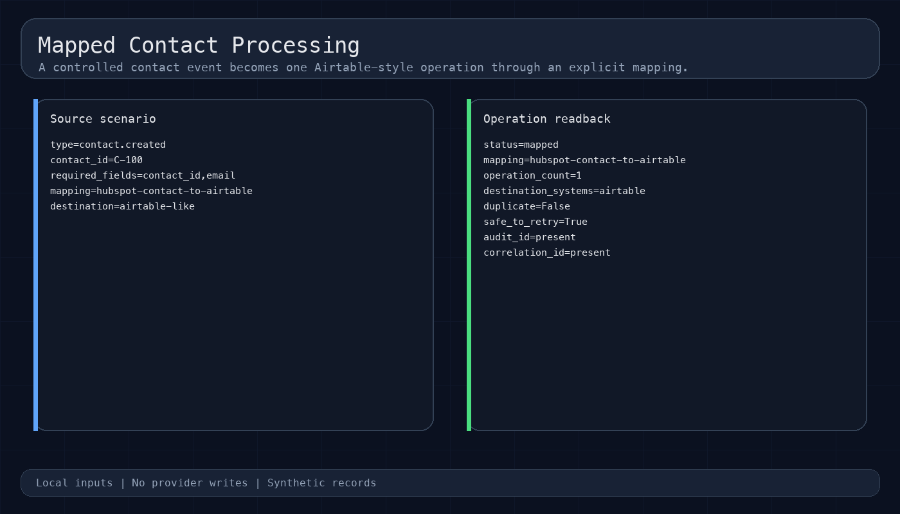

# API Webhook Bridge

Validate incoming events, map approved fields into destination-shaped operations and prevent duplicate delivery. Rejected events remain visible in an audit and dead-letter path.

**Status:** tested local reference implementation with synthetic provider-shaped contracts.

**My contribution:** integration design, FastAPI service, field mapping, idempotency controls and tests.

[Architecture and case study](docs/case-study.md) · [API reference](docs/api.md) · [Dependency contract](docs/automation-kit-backbone.md)



*Generated panel from committed local scenarios; no live provider operation is performed. The full [image sequence](docs/screenshots/README.md) retains the supporting examples.*

## How it works

Requests pass through size/JSON checks, one of three source contracts, explicit field mapping and idempotency checks. The result contains prepared operations, correlation and audit IDs, or a structured duplicate/rejection outcome.

The examples model contact, order and payment events and destinations shaped like Airtable upserts, CRM notes, Slack alerts and payment-audit records. Provider names describe contract shapes. The bridge does not execute destination writes.

FastAPI exposes health, integration discovery, mappings, webhook routes and audit/dead-letter readback. See the [API reference](docs/api.md) for endpoints, validation failures and response contracts.

## Usage

Python 3.11 is the reference runtime. Automation Kit is pinned to `b4b1df2730bc928b8c9ee96f716b706b41856cf1` in package metadata and CI.

```bash
git clone https://github.com/stefan-mcf/automation-kit.git ../automation-kit
git -C ../automation-kit checkout b4b1df2730bc928b8c9ee96f716b706b41856cf1
uv venv --python 3.11 .venv
source .venv/bin/activate
uv pip install -e ".[dev]"
export AUTOMATION_KIT_PATTERNS="$PWD/../automation-kit/patterns"
uvicorn api_webhook_bridge.api:app --host 127.0.0.1 --port 8011
```

Check `http://127.0.0.1:8011/health`; interactive OpenAPI docs are at `/docs`.

## Validation

```bash
python -m pytest tests -q
python -m ruff check src tests scripts
python -m mypy src
examples/run-local-validation.sh
```

The [validation record](docs/validation.md) describes the supplied cases. To regenerate the local visual panels, run `python scripts/capture_screenshots.py`; recorded panel totals are historical, while current checks are reported by CI.

## Scope and current state

All supplied scenarios are synthetic and make no live provider or cloud calls. In-memory idempotency and local JSONL audit stores are reference behavior. Durable storage, scoped adapters, retries, monitoring and deployment are required for a production integration.

Saved responses declare `fixture_safe=true` and `live_services_used=false`.

## Documentation

- [Case study](docs/case-study.md)
- [API reference](docs/api.md) and [local operation](docs/local-operation.md)
- [Validation record](docs/validation.md) and [image index](docs/screenshots/README.md)
- [Automation Kit dependency](docs/automation-kit-backbone.md)
- [Production extension](docs/production-path.md)

MIT. See [LICENSE](LICENSE).
